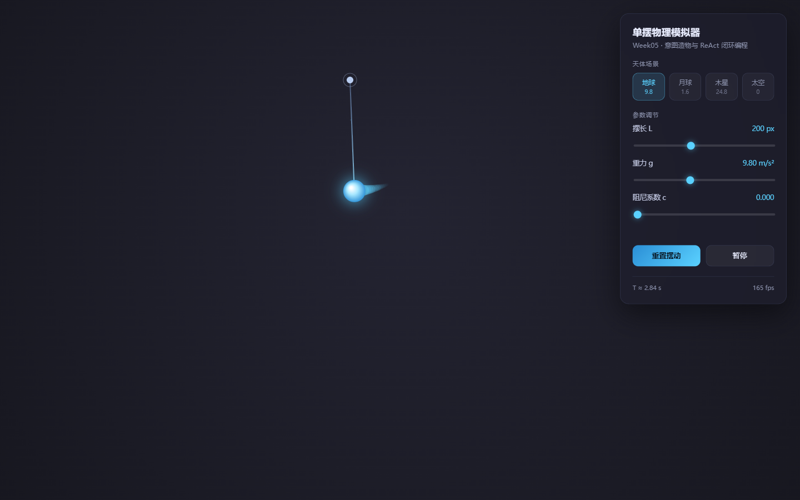
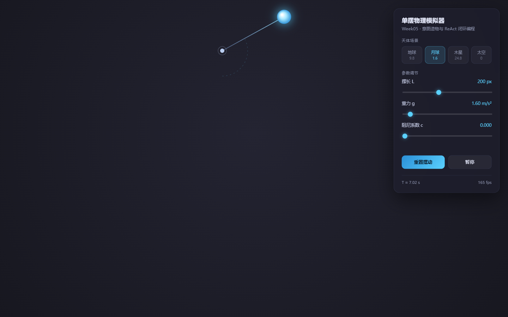
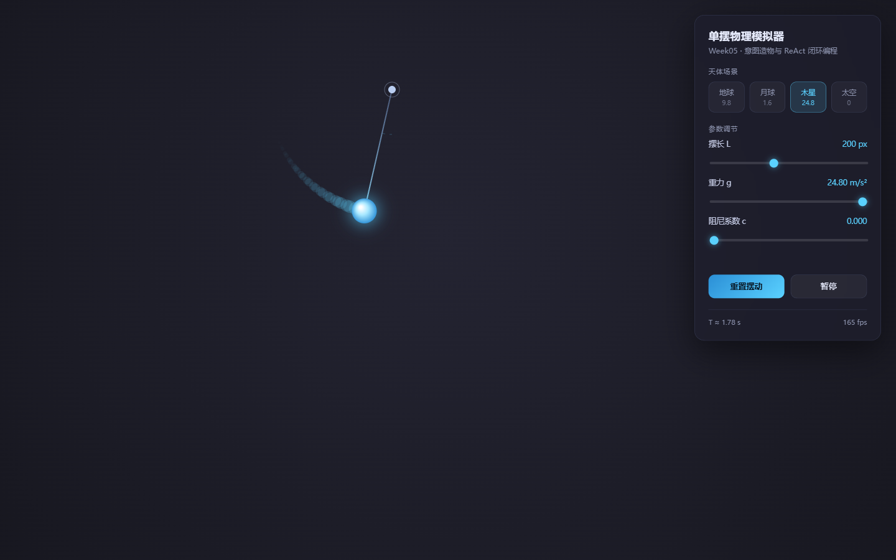
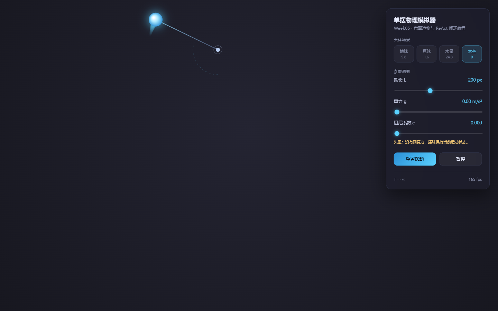
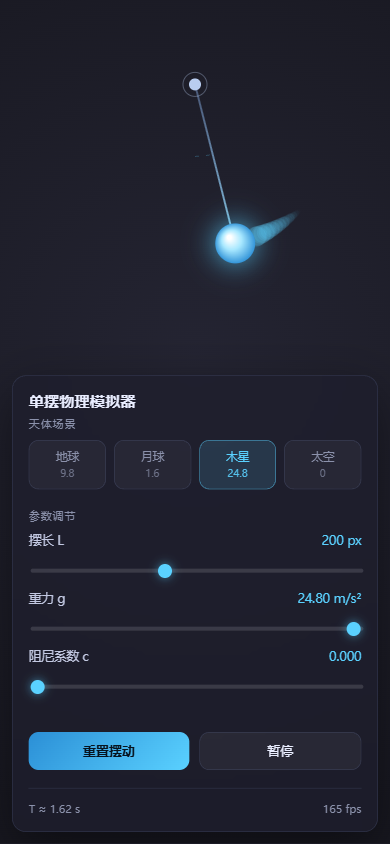

# 进阶挑战 B · 天体场景预设与本地状态持久化

> 对应课件第 9 页「进阶挑战 B」
> 实现状态：✅ 全部完成（含课件要求的 4 项技术约束）

---

## 一、功能清单

| # | 功能 | 实现情况 |
| :---: | :--- | :--- |
| 1 | 四个天体胶囊按钮：地球 9.8 / 月球 1.6 / 木星 24.8 / 失重 0（m/s²） | ✅ 面板顶部一排胶囊，当前生效项高亮 |
| 2 | 点击后重力**平滑过渡**，滑块与数值标签同步更新 | ✅ 缓动逼近目标值，约 0.3 s 收敛，滑块跟随移动 |
| 3 | `localStorage` 自动保存自定义参数 | ✅ 摆长 / 重力 / 阻尼 / 当前场景，任一参数变动即写入 |
| 4 | 页面重新加载自动恢复上次参数 | ✅ 逐项做类型与范围校验后恢复，含场景高亮状态 |
| 5 | 移动端触屏与响应式视口布局 | ✅ ≤760px 时面板转为底部抽屉，摆长按可用高度整体缩放 |

额外补充（课件未要求，但直接影响可用性）：

- 失重场景下的**提示语**：`g = 0` 时没有回复力，摆球会保持当前运动状态。如果不加这句，用户会以为程序卡死；
- 失重场景下周期读数显示 `T → ∞`，而不是显示一个巨大的数字；
- 手动拖动重力滑块会**立即接管**，打断预设过渡，并把高亮切到"无预设"（避免高亮与实际值不一致）。

---

## 二、实现要点

### 2.1 预设与滑块，谁说了算

这是本挑战唯一有设计难度的点。两者都写同一个状态，如果不定义优先级，很容易出现"点了月球、滑块却停在 9.8"的分裂状态。

采用的规则：

- **点击预设** → 只设置 `targetG`（目标值），不动 `g`。由动画循环每帧按 `g += (targetG − g) × min(1, dt × 6)` 逼近，收敛后再精确赋值；
- **拖动滑块** → 直接写 `g`，并把 `targetG` 同步为当前值，等于**立即结束过渡**；
- **高亮状态**由 `matchPreset(g)` 反推：`g` 落在某个预设 ±0.05 内就高亮该项，否则不高亮。

这样无论用户先点按钮还是先拖滑块，视觉状态永远和真实数值一致。

### 2.2 持久化为什么不能只写不校验

`localStorage` 里的数据是不可信的：可能是上一版程序写的（字段对不上）、可能被用户手动改过、也可能是无痕模式下直接抛异常。所以读取时做了三层防护：

1. `getItem` / `setItem` 全部包在 `try...catch` 里，存储不可用时静默降级，功能照常；
2. `JSON.parse` 单独 `try...catch`，格式坏了就当没有存档；
3. 每个字段单独判断 `typeof === 'number' && isFinite`，再按各自量程 `clamp` 一次。

冒烟测试里专门有一条用例，往存储里塞 `{"L":"坏数据","g":999,"c":null}` 和非 JSON 字符串，验证页面仍能正常启动、`g` 被钳到 25 而不是崩掉。

### 2.3 响应式为什么要缩放"物理长度"而不只是缩放画面

窄屏时面板变成底部抽屉，会吃掉下半屏。如果只把画面缩小而物理仍按 200px 计算，就会出现"看起来是短摆、摆起来却是长摆"的矛盾 —— 周期读数会和眼睛打架。

因此缩放系数 `viewScale` 同时作用于**绘制半径**和**运动方程里的 L**：物理长度就是屏幕上看到的长度，读数与观感一致。代价是窄屏下周期会比同参数桌面端略短，这是刻意接受的（同一根摆，屏幕上确实变短了）。

---

## 三、验收步骤（约 2 分钟走完）

| 步骤 | 操作 | 预期结果 |
| :---: | :--- | :--- |
| 1 | 双击 `index.html` | 单摆在深色背景中平滑摆动，面板默认高亮「地球」 |
| 2 | 点击「月球」 | 摆球明显变慢，重力数值在约 0.3 s 内从 9.80 滑到 1.60，滑块同步移动 |
| 3 | 点击「木星」 | 摆动明显变快，滑块跟随到 24.8 |
| 4 | 点击「太空」 | 摆球保持当前姿态不再往复，面板出现失重提示，周期显示 `T → ∞` |
| 5 | 把摆长拖到 300，刷新页面（F5） | 刷新后摆长仍为 300、场景仍高亮「太空」，无需重新设置 |
| 6 | 拖动重力滑块到 15 | 「太空」高亮消失（因为 15 不在任何预设上），说明手动值优先 |
| 7 | 把窗口宽度拉到 400px 左右 | 面板变为底部抽屉，单摆自动缩小并完整显示在面板上方 |

以上 7 步全部通过，控制台无任何红色报错。

---

## 四、为什么选 B 而不是 A

课件给了两个选项，我选了 B：

- **A（双摆混沌 / 相空间轨迹）** 的技术难点在数值积分与混沌系统的稳定性。而我的 MVP 阶段已经用了 RK4（固定步长 1/240），再做一次双摆，本质是把同一套积分方法套到另一组方程上，**边际收益低**；
- **B（天体预设 + 持久化）** 的难点在状态管理与兼容性：两个输入源争同一份状态、刷新后的恢复、脏数据的兜底、窄屏的布局 —— 这些更接近真实工程里的问题，也更能检验"我是在设计，还是在抄"。

另一个现实考虑：B 的每一项都能被**秒级肉眼验证**（点按钮、刷新、拉窗口），而 A 的验收依赖"你觉得这条轨迹够不够混沌"，主观性太强。

---

## 五、已知限制

1. 失重场景下若摆球初始角速度为 0，它会静止不动。这是物理正确的（没有回复力也没有初速度），已用提示语说明；如果想看匀速转动，需自行给一个初速度，当前版本没有暴露这个入口；
2. 阻尼映射用了 `DAMPING_K = 120`（见 README 3.3），因此阻尼滑块上的数字不等于真实的角速度阻尼系数，只表示"衰减强弱"的相对刻度；
3. `localStorage` 按同源隔离，把 `index.html` 换到另一个目录打开会被视为新的存储空间，之前保存的参数不会跟过去。

---

## 六、实现效果截图

以下截图由 **Chrome 155.0.8059.84（headless，页面经本地 HTTP 提供）** 实际渲染后抓取，
不是设计稿，也不是手工渲染的示意图。原图位于 `screenshots/`，桌面端视口 1440×900，移动端 390×844。

**① 地球（默认，g = 9.80，T ≈ 2.84 s）**

**② 月球（g = 1.60，T ≈ 7.02 s）** —— 对应验收步骤 2：摆球明显变慢，滑块与数值同步跟随

**③ 木星（g = 24.80，T ≈ 1.78 s）** —— 对应验收步骤 3：摆动明显变快，拖尾可见

**④ 太空（g = 0，T → ∞）** —— 对应验收步骤 4：摆球不再往复，面板底部出现失重提示

**⑤ 移动端 390×844** —— 对应验收步骤 7：面板转为底部抽屉，单摆在面板上方完整可见；
图中参数为**刷新后从 `localStorage` 恢复**的「木星 24.80」，可直接作为验收步骤 5 的佐证

